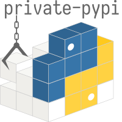
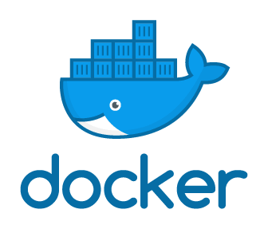

# Welcome! ようこそ！ 👋

## Thanks for stopping by! 👾
Hi, I'm Isaac 👋 \
I live at the intersection of dev-ops & data. \
I deeply admire simplicity. \
An Alaskan who loves the pacific northwest. \
Passionate woodworker, skateboarder, and shredder of beat saber.

Life long engineer, professional kid.

| Current Interests | Want to dive into |
|:---|---:|
| 🤖 Dev Ops | Game Development 🎮 |
| 🗄️ Data Architecture | Voice Applications 🎤 |
| 🌎 Web Development | Crocheting 🧶 |

 

### ***Connect with me!***

‎ ‎ ‎ ‎ ‎

 👈 *My Blog & Resume*

### ***More stuffs!***

‎ ‎ ‎ ‎ ‎

‎ ‎ ‎ ‎ ‎

‎ ‎ ‎ ‎ ‎
